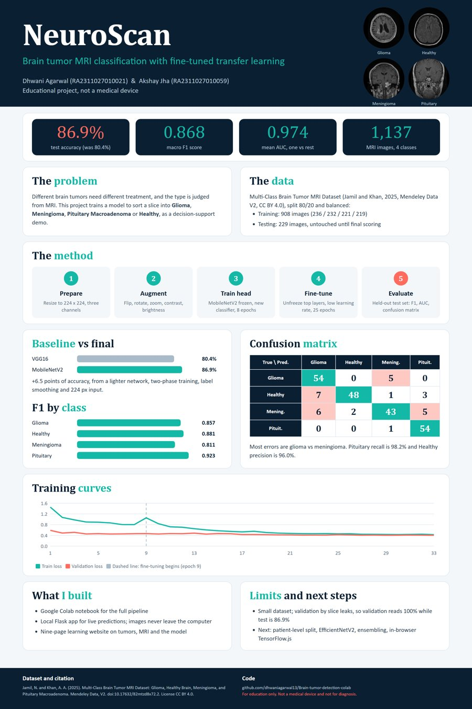

# NeuroScan: Brain Tumor Detection from MRI Scans

[](https://colab.research.google.com/github/dhwaniagarwal13/Brain-tumor-detection-colab/blob/master/Brain_Tumor_Detection_Colab.ipynb)
&nbsp; **Live website:** https://neuroscan-brain-tumor.vercel.app

A deep learning model that classifies a brain MRI slice into one of four categories: **Glioma, Meningioma, Pituitary Macroadenoma, or Healthy**. Built with transfer learning (MobileNetV2), evaluated on a held-out test set, and delivered as a Colab notebook, a local prediction app and a learning website.

**Authors**

| Name | Registration number |
|---|---|
| Dhwani Agarwal | RA2311027010021 |
| Akshay Jha | RA2311027010059 |

> Educational project. Not a medical device and not for diagnosis.

## Results

Evaluated on **229 held-out test images** that were never used for training or model selection.

| Model | Input | Test accuracy | Macro F1 |
|---|---|---|---|
| VGG16 baseline | 128 px | 80.4% | 0.807 |
| **MobileNetV2, two-phase fine-tune (final)** | 224 px | **86.9%** | **0.868** |

| Class | Precision | Recall | F1 | AUC |
|---|---|---|---|---|
| Glioma | 0.806 | 0.915 | 0.857 | 0.967 |
| Healthy | 0.960 | 0.814 | 0.881 | 0.990 |
| Meningioma | 0.860 | 0.768 | 0.811 | 0.949 |
| Pituitary Macroadenoma | 0.871 | 0.982 | 0.923 | 0.989 |

Most errors are glioma / meningioma confusions. Validation accuracy during training reads close to 100% because near-identical slices from one scan can fall on both sides of the split, so the **test set is the number to trust**.

<p align="center"></p>

## How it works

1. **Data**: Multi-Class Brain Tumor MRI Dataset (1,137 images), split 80/20 into 908 training and 229 testing images.
2. **Preprocessing**: resize to 224 x 224; pixel rescaling is part of the model, so training, the notebook, the app and the website all share identical preprocessing.
3. **Augmentation** (training only): flip, rotation, zoom, contrast, brightness.
4. **Training**: phase 1 trains a new classifier head on a frozen MobileNetV2; phase 2 fine-tunes the top layers at a low learning rate, with label smoothing.
5. **Evaluation**: accuracy, per-class precision / recall / F1, one-vs-rest AUC and a confusion matrix on the unseen test set.

## Repository layout

```
.
├── Brain_Tumor_Detection_Colab.ipynb   Full pipeline for Google Colab
├── data/                               Training/ and Testing/ images, plus train.zip and test.zip for Colab
├── models/                             best.keras (final model) and training history
├── src/
│   ├── train.py                        Two-phase MobileNetV2 training
│   ├── evaluate.py                     Test-set metrics -> metrics.json
│   ├── prepare_dataset.py              Raw .mat -> image folders (legacy dataset)
│   └── split_mendeley.py               Seeded 80/20 split of the Mendeley dataset
├── webapp/                             Local Flask predictor (run.bat)
├── website/
│   ├── src/                            Page sources and build.py
│   └── public/                         Built static site (deployed on Vercel)
└── presentation/                       Poster (PDF, PNG) and final presentation (PPTX), with build scripts
```

## Run it

**Colab (recommended).** Upload `data/train.zip` and `data/test.zip` to `MyDrive/BrainTumorMRI`, open the notebook with the badge above, select a T4 GPU runtime and run all cells.

**Local predictor.**
```bash
pip install -r requirements.txt
cd webapp
python app.py          # or run.bat on Windows, then open http://127.0.0.1:5000
```
Images are processed on your own computer and never uploaded anywhere.

**Retrain / re-evaluate.**
```bash
python src/train.py        # writes models/best.keras and models/history.json
python src/evaluate.py     # prints metrics and updates the app and website metrics.json
```

**Rebuild the website or the presentation.**
```bash
python website/src/build.py
cd presentation/build && npm install && node build_deck.js
```

## Dataset

Jamil, N. and Khan, A. A. (2025). *Multi-Class Brain Tumor MRI Dataset: Glioma, Healthy Brain, Meningioma, and Pituitary Macroadenoma.* Mendeley Data, V2. doi:[10.17632/82mtzd8x72.2](https://data.mendeley.com/datasets/82mtzd8x72/2). Licence: CC BY 4.0.

## Limitations and next steps

- Small dataset, and the validation split is by slice rather than by patient.
- No clinical validation.
- Next: patient-level split, a stronger backbone (EfficientNetV2), model ensembling, and in-browser inference with TensorFlow.js so the hosted site can predict as well.
